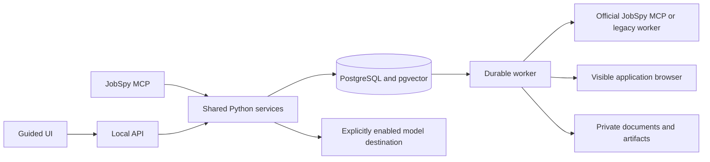

# Architecture decisions

## Current submission boundary

The [external submission migration](EXTERNAL_SUBMISSION_PLAN.md) supersedes the native browser execution sections below. The app exports private application packets for a separate Codex CLI browser session. Queue admission and dispatch reject legacy submission, browser reconciliation, and verification jobs. Legacy sending settings cannot enable those actions. Read-only employer application inspection, field extraction, profile-based suggested answers, document review, history, receipt review, and reviewed tracker writes remain in the app. The copied prompt contains the extracted fields and answers as well as full document paths. Individual questions and answers can also be copied for manual entry. Native executor details below document the archived predecessor and are retained while its modules and tests are retired.

The application consists of a FastAPI service, a React/TypeScript UI, a separate Python worker, PostgreSQL 17 with pgvector, and an MCP stdio server. Personal state lives under `JSA_STATE`; originals stay under `JSA_WORKSPACE`. The API binds to `127.0.0.1:8765` and the database binds to `127.0.0.1:55432`.

## User profile isolation

Migration 010 adds the shared `public.user_profiles` registry. Existing tables and private files remain in place for the `default` profile. Each additional profile has a PostgreSQL schema and a directory under `JSA_STATE/profiles/<id>`. Its source workspace is an existing, separate folder recorded in the registry. Creating a profile does not import files or copy another profile's confirmed facts or model consent.

Connections select exactly one profile schema and the shared `jsa_extensions` schema, which contains pgvector. Additional profiles never search `public` for application tables. Missing profile storage fails closed. Profile registration, schema creation, and migrations commit together. Startup migrates every registered profile.

The API selects a bound application instance using `X-JSA-Profile` or the `profile` query parameter. Conflicting selectors fail; an unknown profile never falls back to the default. Requests without a selector retain the default profile for existing integrations. Authentication uses the installation's shared token. This supports local household use, not separate authenticated accounts or mutually untrusted tenants. Database credentials remain deployment credentials with access to all schemas.

The UI stores the profile in its page URL and reloads on a switch, clearing drafts and pending views. Document and handoff links carry the profile so other tabs cannot redirect them. The worker keeps one bound worker and browser-session collection per profile and polls all registered queues. New profiles are discovered while it runs. MCP subprocesses receive the originating profile ID and installation state root. Approval, receipt, qualification, and tracker review gates remain in their existing services.

The full database backup and private-state archive include all profiles. Deployment environment overrides still control live capabilities; provider/model opt-in settings are profile-specific.

## State and execution

PostgreSQL stores documents, versions, chunks, typed facts, answer caches, applications, approvals, attempts, receipts, artifacts, jobs, conflicts, follow-ups, metrics, and audit events. Versioned SQL migrations run under a database lock. The queue claims work using `FOR UPDATE SKIP LOCKED`, renews leases, saves checkpoints, bounds retries, and preserves cancellation requests. Jobs for the same application are serialized. Duplicate active jobs of the same kind return the existing ID.

The worker handles ingestion, workspace import, searches, inference jobs, package rendering, browser filling, submission, and reconciliation. It runs separately from the API so a UI or API restart does not lose work. Read-only search queries checkpoint completed source responses. Re-ingestion skips unchanged content. A renderer interrupted before completion can retry the same package version.

Application state transitions and business controls live in `workflow.py`. A model cannot waive a qualification gate, change application status, authorize a submission, or establish receipt. The model provider has no tool access.

User package revisions bind notes and the previous structured draft to a saved document version. The request transaction locks the application and active jobs, cancels queued application work, invalidates approval, and queues preparation. Both writing and evidence/prose review receive the feedback. Successful publication retains old files and updates selected attachments by format. A separate document-review record identifies the version the user inspected and grants no submission authority. Revision history remains in durable jobs; notes do not become confirmed career memory.

The application journey uses the shared checkpoint projection in `progress.py` to show one current step and next action. The [workflow guide](WORKFLOW.md) records each gate and recovery path. Role selection uses a shared code projection of the existing primary, conditional, and skip policy. A conditional selection needs an explicit reason; the UI binds that choice to the displayed assessment and records it in the audit log. Selection permits preparation without changing fit evidence or granting submission authority. The journey distinguishes a completed assessment from a completed selection. Manual handoffs can record a `handoff_review` checkpoint in the application payload, bound to the existing review hash. Only the dedicated review endpoint can create it; ordinary payload patches cannot. It records package review without granting submission authority. The checkpoint is reused only while answers, selected files, and required-question resolution still match. Manual submission remains on the employer site, followed by explicit receipt evidence.

The [intervention inbox](INTERVENTIONS.md) projects workflow blockers into persistent notifications. Unknown or unreliable required answers save a manual answer handoff while retaining the resumable `missing_answers` state. Notification acknowledgments never clear workflow blockers or grant approval.

Discard is an explicit workflow decision stored as `skipped` and displayed as Discarded. The transaction locks the application and active jobs, refuses active work or submission history, cancels queued work, invalidates approvals, and resolves notices and follow-ups. Matching search leads become terminal. Queue admission checks the same application lock and rejects discarded roles. First applied scores are retained as audit evidence; older completed model evaluations remain labeled separately in the inbox.

[Requirement decisions](REQUIREMENT_REVIEW.md) bind explicit candidate confirmations or denials to one application's exact requirement. They retain notes and supersession history, update scoring through the existing gates, and invalidate approval. Rescore jobs use the configured inference service; code preserves the saved decisions when applying model output.

## Retrieval and memory

The structured memory lookup order is workflow context, applicable confirmed facts, evidence-backed cache, retrieval, then a user question. Facts record type, scope, provenance, verification time, optional effective dates, and supersession. Conflicting values block factual reuse. Corrections invalidate dependent caches and approvals. Cache identities include candidate, scope, question, policy, fact IDs, and document-version dependencies; every hit is validated.

Ingestion preserves document identities and content-hash versions. Chunks retain document version, order, section, and page/table/row references. PDF/DOCX/HTML renderings with the same package stem share a retrieval group. Explicit history sections and historical source documents are excluded from current retrieval. Generated drafts do not establish career facts. A changed or deleted source invalidates dependent memory and caches while retaining history.

PostgreSQL full-text search and pgvector cosine search produce candidate rankings, fused by reciprocal rank. Optional term-overlap reranking is available. Small documents expand in full, including later pages; larger ones expand the parent section and neighboring chunks within a character budget. Failed or incomplete extraction is shown to the user. DOCX page positions are hints; paragraph and table references are the stable locators. Scanned PDFs need external OCR or manual extraction.

The default embedding provider is a deterministic fixture surrogate for offline evaluation. It is not a learned semantic model. The Ollama provider supports learned embeddings at a configured local or remote server. Language-model judgments use a separate typed inference service with Codex and offline fixture backends. No text is sent until the user enables the displayed destination. A provider or embedding-model change requires re-ingestion. The tested deployment uses exact pgvector search without HNSW: variable provider dimensions and these local per-profile corpora do not justify an approximate index or separate vector service. Add a model-specific HNSW index only after measuring latency and recall on the selected embedding model.

## Approval and recovery

The review payload names the employer, role, requisition, answers, material consents, form schema, and actual attachments. Its hash binds the approval to that content. The worker verifies current answer evidence, hashes the selected local files, and compares browser file bytes and field values before the final action. Continue, Save, Submit, and attestation-like actions remain guarded until that check passes.

The database records a unique submission attempt before the click. A restart after this checkpoint produces an unresolved state and blocks another attempt. A receipt must identify the requisition and confirm receipt. An explicit user confirmation is a separate evidence type. Submitted payloads and copies of actually attached documents are preserved by hash; prepared but unattached cover letters are not marked submitted.

Greenhouse separates browser review from sending. Review uses the native page with outbound candidate traffic blocked and file uploads staged inside Playwright. It creates no submission attempt. An approved sending run opens a fresh browser and records the attempt before any actual upload. Its transport checks the storage request and the final JSON application independently. A resumed manual handoff may return to filling only when no prior submission attempt exists. [Employer form adapters](EMPLOYER_FORMS.md) document supported controls and remaining limits.

A completed Greenhouse run can establish that it stopped before releasing the final application request. In that case, a dedicated retry action revalidates the original approval, evidence, files, form, and opening. It reuses the attempt and approval rather than deleting history. Each resumed run gets a new identifier, so it cannot borrow an earlier run's stop evidence. The transport persists `send_started` before releasing the POST. A missing stop record, mismatched run, released POST, changed approval, or unknown outcome blocks retry. A worker restart never initiates this recovery action.

The real and fixture trackers share a reviewed writer with a file lock, preview hash, expected-file-hash check, backups, ZIP verification, atomic replacement, and recovery journal. Real writes require separate deployment enablement. Generated notes, checklist, and handoff under `_Agent` are reconciled after replacement. Recovery verifies hashes before finishing interrupted work. External edits produce a conflict; imported ODS status remains authoritative without granting a runtime workflow a receipt. [Metrics and tracker updates](TRACKER.md) describes the UI, matching rules, and recovery limits.

Email verification is a continuation of the approved attempt. Recognized Greenhouse HTTP 428 challenges pause the workflow. An explicit **Continue verification** action uses the code entered in the original employer browser; codes and native request tokens never enter the queue or durable records. Each continuation validates the approval and application payload again. The worker permits at most three verification sends and captures an employer receipt before marking the application submitted. Losing the browser session blocks continuation; a worker restart cannot reconstruct or replay it.

For an unresolved initial Greenhouse run with a completed HTTP 428 stop record, the user can explicitly confirm that verification was never completed and that they did not submit elsewhere. This negative outcome confirmation is bound to the attempt, run, stop event, and approved payload. It creates no receipt and queues no work. A separate retry revalidates the original approval, files, evidence, and opening. The prior run result is archived before a new run begins. Missing stop evidence, an observed success, any later verification continuation, active work, or a recorded receipt blocks this recovery path. Unknown outcomes cannot be cleared merely because no confirmation email arrived.

## Integration documentation checked

Implementation references were checked against the current official documentation on October 19, 2026:

- [MCP Python SDK server tools and structured output](https://py.sdk.modelcontextprotocol.io/servers/structured-output/). The implementation pins SDK 2.3.0, uses `MCPServer`, parameterized structured return types, and protocol tests through the SDK client.
- [FastAPI lifespan events](https://fastapi.tiangolo.com/advanced/events/) for migration startup.
- [Playwright browser contexts](https://playwright.dev/python/docs/api/class-browsertype) for visible persistent contexts, isolated profiles, and guarded requests.
- [pgvector hybrid search](https://github.com/pgvector/pgvector) for vector and PostgreSQL lexical retrieval.
- [Ollama embeddings](https://docs.ollama.com/api/embed) and [structured chat requests](https://docs.ollama.com/api/chat) for configurable providers.
- [Vite setup](https://vite.dev/guide/) for the pinned React build. The installed 7.x release was updated to 7.3.7 after npm audit identified issues in the initial pin.

Dependencies are exact-pinned in `requirements.lock` and `web/package-lock.json`. The database image is pinned by digest. The official JobSpy MCP runs in a separate environment pinned by `requirements-jobspy-mcp.lock`. The legacy backend retains its own checkout and environment. [The comparison and integration guide](JOBSPY_MCP_COMPARISON.md) records the live sample and rollback procedure.

## Codex inference boundary

`llm_runs` and `llm_events` record evidence snapshots, model routes, validated outputs, numeric usage, and operational lifecycle events. The queue executes bounded `codex exec` tasks in private directories. A PostgreSQL lock serializes model processes; a Linux supervisor prevents orphaned Codex clients after worker death. Results are proposals and cannot grant workflow authority. The package workflow uses this boundary for structured writing and a separate claim review, then renders HTML through LibreOffice DOCX to US Letter PDF. [Document preparation](DOCUMENTS.md) describes its contracts, checks, and versioned previews. [Codex job contracts and recovery](CODEX_JOBS.md) describe the task modules, data destination, cache identities, and validation limits.

## Autonomous search coordinator

The UI calls the hunt service. Its durable coordinator invokes JobSpy through the SDK's stdio MCP client, then queues requirement extraction, fit assessment, and package generation through the existing inference and worker contracts. Coordinator ticks yield between phases so one worker can execute child jobs without deadlock. The coordinator is code; models interpret bounded evidence packets and do not orchestrate tools or grant approvals.

Migration 006 adds run and discovery records. New real proposals can advance through preparation while imported applications remain read-only. Private generated packages are indexed as drafts through a separate corpus namespace. [Autonomous search](AUTONOMOUS_SEARCH.md) describes verification coverage, data paths, bounds, and recovery. [Employer form preparation and sending](EMPLOYER_FORMS.md) describes typed form inspection, scoped answers, fit reevaluation, local Greenhouse browser review, and the approval-bound Lever and Greenhouse executors. Real sending is enabled separately from per-application authorization. Both processes read the saved private deployment setting on startup; explicit environment configuration overrides it. Enabling the deployment does not create approvals or queue applications.

## Self-identification boundary

Self-identification answers use typed field metadata and confirmed memory, separate from career inference. Their reusable identity covers question wording, selection type, available labels, and free-form capability; employer option IDs stay in the versioned form contract. No model or retrieved source can establish a user's survey choice. These saved facts are excluded from model context, and demographic consent remains application-scoped. See [saved self-identification answers](EMPLOYER_FORMS.md#saved-self-identification-answers) for browser and transport checks.

Manual package review no longer marks submission approval complete in the journey. An unattempted manual handoff can update its fit assessment without losing its preparation checkpoint. Recorded attempts block rescoring and requirement edits. This recovery preserves documents and answers and grants no submission authority.
