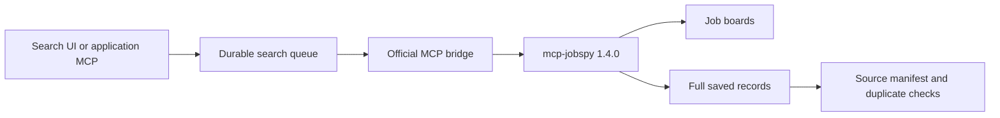

# JobSpy MCP comparison and integration

## Decision

Use upstream `mcp-jobspy` 1.4.0 for live discovery while retaining JobSearchAgent's durable search queue, saved presets, source warnings, application duplicate checks, profile routing, and result pagination. Keep the legacy worker as an explicit rollback option. Do not silently retry a failed official search through a different backend.

This is an upstream-maintenance change. The live comparison below did not establish better recall or relevance.

## What was installed before the comparison

The project's `jobspy-mcp` entry point runs `jobsearch.mcp_server`, a local server written for this application. Search execution used the sibling JobSpy checkout's `search_jobs.py` and `python-jobspy` 1.3.0. The app and its agents reached that local MCP for search orchestration.

The similarly named upstream **`mcp-jobspy`** package is maintained in [speedyapply/JobSpy](https://github.com/speedyapply/JobSpy). Its package delegates to `python-jobspy[mcp]` at the same version. [Release 1.4.0](https://github.com/speedyapply/JobSpy/releases/tag/v1.4.0) introduced the native MCP and structured source errors and warnings. Other packages named `jobspy-mcp` or `jobspy-mcp-server` are separate projects.

| Concern | Existing local solution | Official MCP 1.4.0 |
| --- | --- | --- |
| Discovery engine | JobSpy 1.3.0 through a local JSON worker | JobSpy 1.4.0 through upstream MCP |
| MCP tools | Durable searches, progress, cancellation, paginated results, duplicate grouping; application handoff export | `search_jobs`, `get_job_details` |
| Job details | Complete worker output saved on disk | Preview capped at 25 jobs per board; full records through details or saved export |
| Source failures | Captured logging and local classification | Structured errors and warnings by board |
| Restart behavior | Saved query checkpoints and result files | Last 20 searches in server memory; lost on restart |
| Profiles and application history | Application-owned | Not supplied by upstream |
| LinkedIn remote filter | Removed by local worker; warning recorded | Unsupported; upstream warns that it is ignored |

The official board list is LinkedIn, Indeed, Glassdoor, ZipRecruiter, Bayt, Naukri, BDJobs, and HelloWork. Google Jobs is absent from this version's [tool schema](https://github.com/speedyapply/JobSpy/blob/v1.4.0/jobspy/mcp.py). Switching MCPs does not remove board blocking or establish that a listing permits remote work from the user's location.

## Live comparison on October 22, 2026

Both backends searched `.NET software engineer`, location `USA`, posting age 168 hours, five results per board, with descriptions requested. The remote flag was requested; the legacy worker dropped it for LinkedIn as it does in production. The official server received it and returned its unsupported-filter warning. Each board ran once per backend on the same workstation, sequentially. No application was created or submitted.

| Board | Legacy results | Official results | Shared job URLs | Full descriptions |
| --- | ---: | ---: | ---: | --- |
| Indeed | 5 | 5 | 5 | All five from both |
| LinkedIn | 5 | 5 | 5 | All five from both |

No board failed in this sample. Both backends marked only one of the five LinkedIn results remote. The official server's `get_job_details` also returned the selected full records. These small, capped searches establish compatibility, not broader result quality. Sequential calls and server startup differences make their timings unsuitable for a speed claim. Regional boards and blocked-board recovery were not live-tested.

Private raw results and the parameter record are under `$JSA_STATE/integrations/jobspy-evaluation/`. They are excluded from Git. A separate run through the integrated application search service returned five Indeed records with no source errors.

## How the project uses the official server



The bridge calls the upstream `search_jobs` tool with a private `save_to` path and checks its complete saved record count. It does not ingest only the chat preview or rely on an expiring upstream search ID. Existing per-query deadlines, cancellation, warning display, durable checkpoints, and profile-specific research folders remain in the application. A manifest records which backend ran; resumed searches retain that selection.

On Linux, the upstream process is tied to its parent worker's lifetime so hard timeout termination also ends the scraper. Fixture searches stay offline and do not start either scraper. Synthetic MCP tests cover full exports larger than the preview, source failures, ignored filters, saved configuration, household profile isolation, and checkpoint reuse.

Search presets and deduplication now live in the application. Existing `JSA_JOBSPY/search_profiles.json` presets are read when present. Otherwise portable US search presets are used. The official backend needs no sibling JobSpy source checkout. The legacy backend still needs its existing checkout and environment.

## Install, enable, and roll back

From the application checkout:

```bash
.venv/bin/python scripts/install_jobspy_mcp.py
# Installs and verifies tools without changing the selected backend.
.venv/bin/python scripts/install_jobspy_mcp.py --enable
# Restart the API and worker after enabling.
.venv/bin/python scripts/services.py stop
.venv/bin/python scripts/services.py start
```

The separate environment lives at `$JSA_STATE/integrations/mcp-jobspy-1.4.0`. Its dependencies are pinned in `requirements-jobspy-mcp.lock`; the app's Python environment remains separate. The installer checks dependency compatibility, versions, and MCP tool discovery before saving the backend selection. It does not enable live network searches if they were disabled.

The saved installation setting is `$JSA_STATE/jobspy-settings.json`. `JSA_JOBSPY_BACKEND` overrides it; `JSA_JOBSPY_MCP_PYTHON` overrides the isolated Python executable. To roll back, start both services with `JSA_JOBSPY_BACKEND=legacy`, or save `backend: legacy` in that private settings file and restart them. Existing completed results remain readable. Backend selection is shared across the installation; candidate facts, queues, and results remain profile-scoped.

For a separate AI client that needs raw upstream search tools, use the installed environment's `bin/mcp-jobspy` command. Keep the application's `jobspy-mcp` entry for durable workflow and handoff tools. The [upstream setup guide](https://github.com/speedyapply/JobSpy/blob/main/mcp/README.md) describes client configuration; use the pinned installation here rather than fetching `latest` on every launch.
